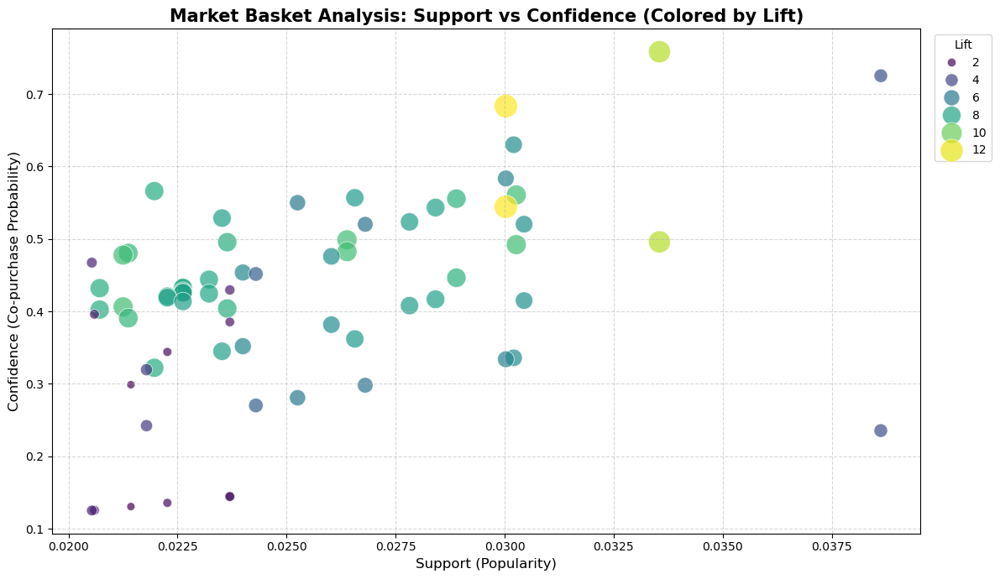

# Market Basket Analysis (MBA) for Retail

## Project Overview
This project applies **Market Basket Analysis** using the **Apriori Algorithm** to uncover hidden patterns in customer purchasing behavior. By analyzing transactional data, the pipeline identifies products that are frequently bought together, providing actionable insights for cross-selling, dynamic product placement, and bundle promotions.

## Key Features & Architecture
Unlike basic scripting, this project is built with a **production-ready mindset**:
* **Modular Pipeline:** The codebase is structured into reusable, isolated functions (`load_data`, `clean_data`, `create_basket`, `generate_rules`).
* **Memory Optimization:** Replaced standard Pandas `pivot_table` with `TransactionEncoder` to handle large, sparse datasets safely without triggering `MemoryError`.
* **Professional Logging:** Implemented the built-in `logging` library with timestamped event tracking for debugging and monitoring, rather than standard `print()` statements.
* **Error Handling:** Robust `try-except` blocks ensure the pipeline gracefully handles missing files or visualization errors.

## Business Insights Discovered
Based on the Association Rules generated (filtered by `min_support=0.02` and `min_lift=1.0`), several distinct consumer behaviors were identified:

1. **Variant Collectors (Strong Association):** Customers buying the *Sweetheart Ceramic Trinket Box* have a **75.8% probability** of also buying the *Strawberry Ceramic Trinket Box* (Lift: 11.21).
   * **Strategy:** Display variant motifs side-by-side or trigger a "You might also like..." pop-up during checkout.
2. **Set Builders:** Purchasing a *Heart of Wicker Small* leads to a **56% probability** of buying the *Heart of Wicker Large* (Lift: 9.12).
   * **Strategy:** Create discounted "Wicker Heart Family" bundle sets to increase the Average Order Value (AOV).

## Tech Stack
* **Python 3.10**
* **Pandas & NumPy:** Data Cleaning and Manipulation
* **MLxtend:** `TransactionEncoder`, `apriori`, `association_rules`
* **Matplotlib & Seaborn:** Data Visualization

## How to Run
1. Clone this repository.
2. Ensure you have the required dataset `Online Retail Data.csv` in the root directory.
3. Install the dependencies:
   ```bash
   conda create -n mba_project python=3.10 pandas numpy scipy matplotlib seaborn mlxtend ipykernel openpyxl -c conda-forge -y
   conda activate mba_project
4. Run the complete pipeline inside the MBA.ipynb notebook.

## Visualizing the Rules
The scatter plot below maps the generated rules based on their Support (Popularity), Confidence (Co-purchase Probability), and Lift (Strength of Association).
